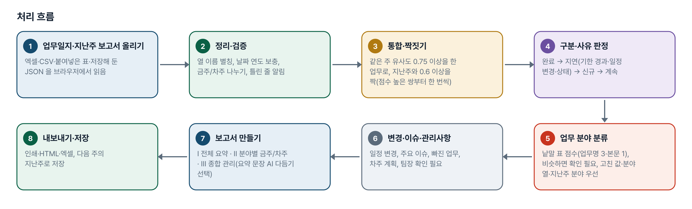
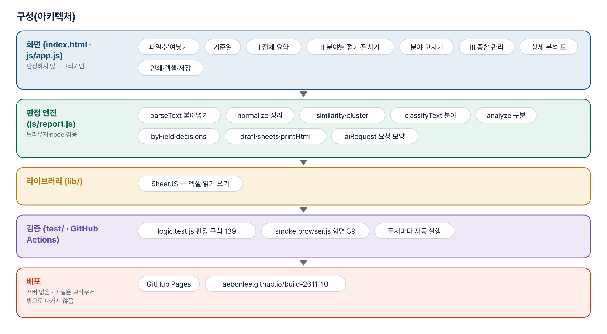
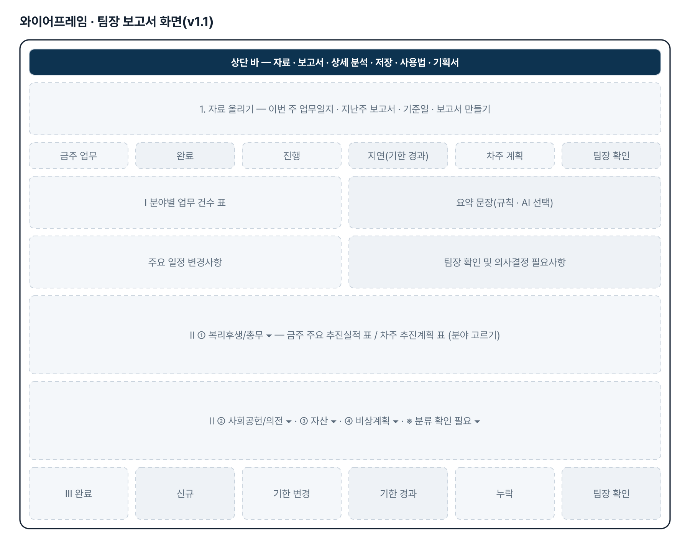
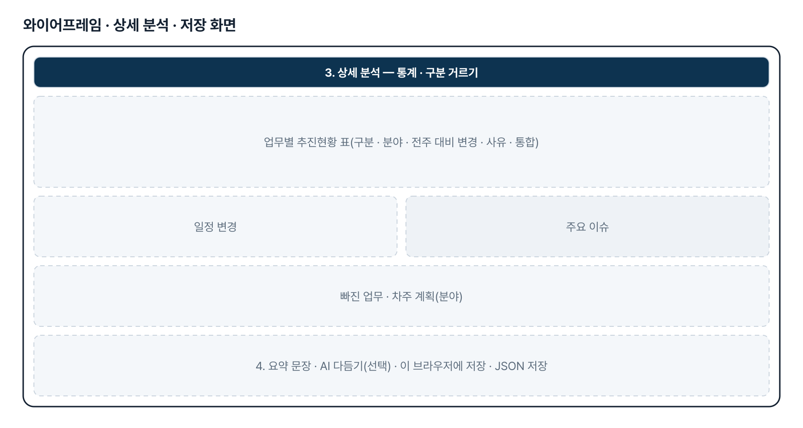
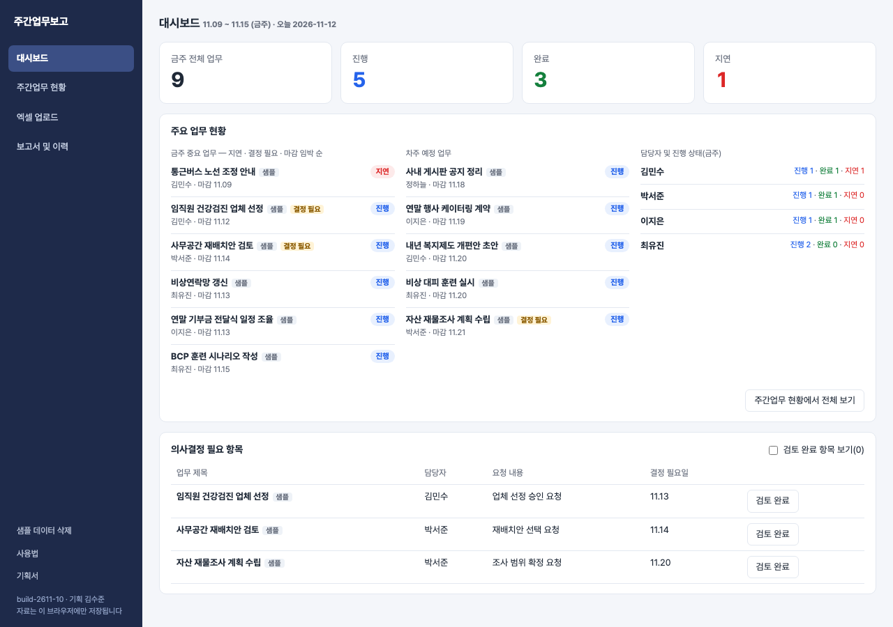

# 주간업무보고 — 프로젝트 기획서 v2.2

- 기획: 김수준 · 작성일 2026-11-12 · 생성형 AI 업무자동화 전문가과정 · 2차수 프로젝트 10
- 바로 쓰기: https://build-2611-10.jobability.co.kr/
- 워드 판: `docs/기획서/build-2611-10_김수준_주간업무보고_기획서_v2.2.docx`

## 개요

팀원들의 엑셀 주간업무보고를 올리면 날짜 · 주요내용 · 마감일 · 세부내용을 원문 그대로 취합해 금주 · 차주로 나누고, 진행 · 완료 · 지연과 의사결정 필요 항목을 대시보드로 보여 주는 심플한 업무 현황 도구입니다. 메뉴는 네 개이고 자료는 브라우저에만 저장됩니다.

### 배경 · 현재 업무
- v1.x(지난주 보고서와 비교해 신규 · 계속 · 완료 · 지연을 나누고 분야별 보고서를 만드는 도구)는 메뉴와 정보가 많아 팀장이 한눈에 보기 어려웠습니다.
- 기획자가 「심플형」으로 다시 정리한 프롬프트와 직접 만든 시제품(HTML)을 올려 수정을 요청했습니다.
- 애본님 지시로 v1.1 은 17번으로 옮겨 그대로 두고, 10번을 새 요청대로 다시 만들었습니다.

### 목표
- 메뉴 4개(대시보드 · 주간업무 현황 · 엑셀 업로드 · 보고서 및 이력)로 줄입니다.
- 엑셀에서 4개 항목만 원문 그대로 추출해 미리보기 뒤 등록합니다.
- 금주 · 차주를 좌우로 나란히 보여 주고 담당자 · 분야 · 상태는 필터로 봅니다.
- 대시보드에는 핵심 숫자 · 중요 업무 · 의사결정 필요 항목만 둡니다.

## 요구사항과 구현

| 기획서 요구 | 구현 |
|---|---|
| 디자인 — 네이비 사이드바 · 카드형 · 작은 글씨 · 장식 없음 | 기획자 시제품의 색(네이비 #1e2a4a · 블루그레이 배경)과 배치를 따른 css/weekly.css. 외부 글꼴 CDN 없이 Pretendard → Noto Sans KR → 시스템 글꼴 순 |
| 왼쪽 메뉴 4개 | 대시보드 · 주간업무 현황 · 엑셀 업로드 · 보고서 및 이력. 사용법 · 기획서 · 샘플 삭제는 사이드바 아래 작은 링크 |
| 대시보드 — 현황 카드 4개 · 주요 업무 · 의사결정 | 금주 전체 · 진행 · 완료 · 지연 자동 집계, 금주 중요 6건(지연 → 결정 필요 → 마감순) · 차주 예정 · 담당자별 상태, 의사결정 표(검토 완료는 기본 숨김) |
| 주간업무 현황 — 금주 · 차주 좌우, 따로 스크롤 | 같은 너비 두 칸(.cols), 칸마다 overflow:auto. 상단 필터(담당자 · 분야 · 상태), 이전 주 · 다음 주 이동 |
| 세부내용 접힘 · 펼치기(업무마다 독립) | 업무 행을 누르면 그 업무만 펼침, 원문은 pre-wrap 으로 줄바꿈 유지. 펼친 자리에서 상태 · 분야 변경, 수정 · 삭제(한 번 더 확인) |
| 업무 등록 · 수정 · 삭제 | 현황 화면 위쪽 입력 카드. 같은 주 · 담당자 · 주요내용이 겹치면 한 번 더 확인 |
| 엑셀 업로드 — 4개 항목 추출 | SheetJS(동봉)로 XLSX · XLS 여러 파일 · 여러 시트. 머리글 이름으로 열 식별(순서 무관), 원문 그대로(공백 · 줄바꿈 유지), 빈 셀은 빈 값 |
| STEP 01~04 · 등록 전 미반영 | 올리기 → 추출 → 미리보기(담당자 · 날짜 · 내용 수정, 등록 안 함 체크) → 최종 등록. 등록 단추 전에는 저장하지 않음 |
| 담당자는 파일명 또는 사용자 선택 | 파일 이름의 한글 2~4자 낱말에서 후보(흔한 낱말 제외), 없으면 비워 두고 입력해야 등록 가능 |
| 중복 의심 확인 | 같은 주 + 담당자 + 주요내용(띄어쓰기 무시)이 같으면 표시, 기본 「등록 안 함」 — 풀면 등록 |
| 금주 · 차주 자동 배치, 엑셀에 없는 항목은 미분류 | 날짜가 속한 주(월요일 시작)로 배치, 분야 · 상태 · 의사결정은 비워 두고 현황 화면에서 지정 |
| 보고서 및 이력 | 주차별 보고서(분야별 묶음, 인쇄 · 엑셀), 담당자별 업무 이력, 상태 변경 · 수정 · 삭제 이력, 엑셀 업로드 이력, 검색 |
| 지연 표시 · 새로고침 후 유지 · 샘플 구분 | 지연은 저장하지 않고 마감일로 계산. localStorage 저장, 백업 JSON. 샘플은 is_sample 로 표시하고 한 번에 삭제 |
| 추후 Supabase 연동 가능한 데이터 구조 | tasks · logs 두 표 모양(납작한 칸)으로 저장 — 기획자 시제품의 칸 이름과 맞춤 |

## 주요 기능

- **대시보드** — 금주 숫자 4개, 중요 업무, 차주 예정, 담당자별 상태, 의사결정 필요 항목.
- **주간업무 현황** — 금주 · 차주 좌우 두 칸, 필터, 세부내용 펼치기, 등록 · 수정 · 삭제.
- **엑셀 업로드** — 4단계 — 올리기 · 추출 · 미리보기 · 최종 등록. 원문 유지, 중복 의심 확인.
- **보고서 및 이력** — 주차별 보고서와 담당자 · 상태 변경 · 업로드 이력, 인쇄 · 엑셀 · 백업.

## 처리 흐름(파이프라인)

1. **엑셀 올리기** — 여러 파일 · 여러 시트
2. **4개 항목 추출** — 머리글로 열 찾기, 원문 그대로
3. **미리보기** — 담당자 · 배치 · 날짜 · 중복 확인
4. **최종 등록** — 업무로 저장, 업로드 이력
5. **분야 · 상태 지정** — 현황 화면에서
6. **대시보드** — 집계 · 중요 업무 · 의사결정
7. **보고서** — 주차별 · 인쇄 · 엑셀

## 구성(아키텍처)

- **화면 (index.html · js/app.js · css/weekly.css)** — 사이드바 메뉴 4개 · 대시보드 · 금주/차주 두 칸 · 업로드 4단계 · 보고서 · 이력
- **엔진 (js/weekly.js)** — 날짜 읽기 · 머리글 식별 · 추출 · 주 계산 · 배치 · 상태(지연 계산) · 중복 의심 · 보고서 표
- **저장** — tasks · logs · 백업 JSON
- **동봉 라이브러리** — SheetJS

## 화면 구성(와이어프레임)

## 규칙 · 판정 기준

- 상태는 진행 · 완료 · 지연 세 가지입니다. 지연은 저장하지 않고 「완료가 아니고 마감일이 오늘보다 앞」이면 지연으로 계산합니다(마감일 당일은 지연이 아님). 상태를 고르지 않은 업무는 진행으로 셉니다.
- 주는 월요일에 시작합니다. 업무는 날짜가 속한 주에 배치하고, 날짜가 없으면 마감일로 배치합니다.
- 엑셀의 주요내용 · 세부내용은 원문 그대로 둡니다(앞뒤 공백 · 줄바꿈 · 문단 포함). 셀 전체가 빈칸일 때만 빈 값입니다.
- 읽지 못한 날짜는 비워 두고 원문을 보여 줍니다. 날짜를 추정하지 않습니다.
- 분야 · 상태 · 의사결정 여부는 엑셀에 없으므로 등록할 때 비워 둡니다(미분류).
- 중복 의심 = 같은 주 + 담당자 + 주요내용(띄어쓰기 · 기호 무시)이 같음. 자동으로 지우지 않고 사용자에게 확인합니다.
- 최종 등록 전에는 아무것도 저장하지 않습니다.
- 대시보드의 중요 업무는 지연 → 결정 필요 → 마감 빠른 순으로 6건까지, 완료는 빼고 보여 줍니다.
- 샘플은 is_sample 로 구분하고 실제 등록 데이터와 섞어 지우지 않습니다.

## 검증

- 계산 규칙 테스트 58개 · 화면 연기 테스트 61개 통과
- 규칙 36개 — 주 계산, 날짜 읽기, 머리글 식별, 원문 유지 추출, 담당자 후보, 상태 · 배치 · 집계, 필터, 중복 의심, 등록, 보고서, 저장본.
- 일부러 깨뜨려 확인 — 지연 판정을 「마감일 당일 포함」으로 바꾸면 3개, 중복 판정에서 주 조건을 빼면 1개가 실패합니다.
- 화면 47개 — 메뉴 4개 · 대시보드 집계 · 검토 완료 숨김 → 두 칸 너비 · 따로 스크롤 · 펼치기 · 필터 → 등록 · 수정 · 삭제 → 엑셀 2개(열 순서 다름 · 시트 2장 · 중복 · 날짜 오류) → 최종 등록 → 보고서 · 이력 · 엑셀 → 새로고침 유지 · 샘플 삭제 → 390 · 820px 넘침 없음.

## 이번 판에서 하지 않는 것

- 자료는 한 브라우저에만 있습니다. 팀원이 각자 올린 자료가 자동으로 합쳐지지 않습니다 — 취합 담당자 한 사람이 올리거나 백업 파일로 옮깁니다. 여러 사람이 함께 쓰려면 Supabase 같은 서버 저장소가 필요합니다(데이터 구조는 맞춰 둠).
- 분야를 자동으로 분류하지 않습니다(이번 요청: 엑셀에 없는 항목은 미분류). 자동 분류가 필요하면 17번의 분류 규칙을 가져올 수 있습니다.
- 지난주 보고서와 비교해 신규 · 계속 · 누락을 가려내는 기능은 17번에 있습니다.
- 로그인 · 권한이 없습니다. 주소를 아는 사람은 자기 브라우저에서 따로 씁니다.
- 업무분류 자동 분류는 낱말 규칙입니다. 문맥을 이해하는 AI 가 아니므로 미리보기에서 확인하고 고쳐야 합니다.
- 담당자 자동 추출은 「담당: 이름」 표기와 등록된 담당자 이름 대조 두 가지뿐입니다. 문맥으로 사람을 추정하지 않습니다.

## 다음 단계

- 실제 팀 엑셀 양식(머리글 이름)으로 추출 확인
- 분야 자동 제안(17번 규칙 재사용) 여부 결정
- Supabase 연동(tasks · logs 표, 로그인)
- 의사결정 항목 알림

## 버전 이력

- **v2.2** (2026-11-13) — 담당자 자동 추출 · 관리(기획자 [수정요청] 5 · 6) — 엑셀에 「담당자」 열이 있으면 그 값 우선, 비어 있으면 업무 내용에서 찾음(「담당: 홍길동」처럼 적힌 이름, 또는 등록된 담당자 이름이 한 사람만 나올 때). 그래도 없으면 파일 이름의 담당자, 그것도 없으면 빈칸 / 엑셀 양식에 「담당자」 열과 등록된 담당자 선택 목록 추가(목록에 없는 이름도 직접 적을 수 있음) / STEP 03 미리보기에서 행마다 담당자를 고르거나 적어 고칠 수 있고, STEP 04 에서 그 값을 저장 / 우선순위(업무분류 · 담당자 공통): 엑셀 값 → 자동 → 미리보기에서 고친 값이 최종
- **v2.1** (2026-11-13) — 업무분류 추가(기획자 [수정요청]) — 복리후생/총무 · 사회공헌/의전 · 자산 · 비상계획 · 미분류 / 엑셀에 「업무분류」 열이 있으면 그 값을 우선 쓰고, 비어 있으면 제목 · 세부내용의 낱말로 자동 분류. 맞는 낱말이 없거나 두 분류에 똑같이 걸리면 미분류 / 엑셀 양식에 「업무분류」 열과 선택 목록(드롭다운) 추가 / STEP 03 미리보기에서 업무분류를 직접 고르고, STEP 04 등록 때 그 값을 저장 / 첫 화면 사진 3장(기획자 제공)
- **v2.0** (2026-11-12) — 심플형으로 다시 만듦 — 메뉴 4개(대시보드 · 주간업무 현황 · 엑셀 업로드 · 보고서 및 이력) / 엑셀 4개 항목 원문 추출 · 미리보기 · 최종 등록, 중복 의심 확인 / 금주 · 차주 좌우 두 칸, 세부내용 펼치기, 의사결정 필요 항목 / v1.1(지난주 비교 · 분야별 보고서)은 17번으로 옮김 / 규칙 테스트 36 · 화면 테스트 47
- **v1.1** (2026-11-03) — (17번으로 옮김) 보고서 최상위 분류를 업무 분야 4개로 개편
- **v1.0** (2026-11-02) — (17번으로 옮김) 첫 판 — 업무일지와 지난주 보고서 비교
